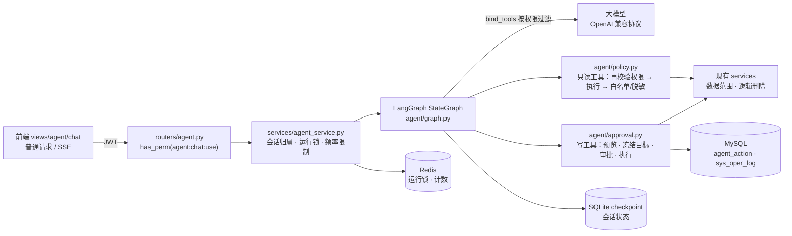

# 智能助手设计说明

在若依 FastAPI 后端上加一个"带权限控制的后台智能助手"：管理员用自然语言查询用户、角色、部门、登录日志、
在线会话，并发起停用/启用账号、解锁、强制下线三类写操作。写操作必须经过人工审批才会执行。

核心原则：**模型只负责"理解意图、选择工具、组织语言"，所有安全判断都在服务端完成**。
提示词里的规则只用来提高体验（少走弯路、说得准确），任何一条安全性都不依赖模型遵守提示词。

## 1. 架构



图的节点：

```
START -> agent -(无工具调用)------------------------------------> END
              \-(含只读调用)-> tools ---------------------------> agent
              \-(只有写调用)-> propose -(生成了 action)-> approval(interrupt) -> execute -> agent
                                       \-(全部被拒绝)-------------------------------------> agent
```

| 模块 | 职责 |
|---|---|
| `agent/tools.py` | 12 个工具的规格：参数模型、所需权限、输出字段白名单、脱敏字段；写工具的预览/执行函数 |
| `agent/policy.py` | 系统提示词、按权限绑定工具、只读工具执行、工具调用分流、历史裁剪 |
| `agent/write_tools.py` | 写操作目标解析（按登录账号精确匹配）、规则校验、预览、按冻结目标执行 |
| `agent/approval.py` | 生成 agent_action、审批结果的 ToolMessage、执行（条件更新抢执行权）、操作日志 |
| `agent/graph.py` | StateGraph、能力边界注入、循环保护（重复调用 / 连续无进展提前结束）、步数与时间上限、模型调用异常脱敏 |
| `agent/serialization.py` | 工具结果封装（untrusted_data）、脱敏、截断、禁止字段过滤 |
| `services/agent_service.py` | 会话、运行锁、频率限制、调用/恢复图、普通与 SSE 两种返回 |
| `services/agent_action_service.py` | agent_action 的状态机（每次迁移都是条件 UPDATE） |

## 2. 一次请求的生命周期

1. **入口校验**：`agent:chat:use` 权限 → 频率限制（Lua 原子 INCR+EXPIRE）→ 会话归属（conversation_id 只能由服务端生成）
   → 运行锁（`SET NX EX`，同一用户同一时间只跑一个图）。
2. **模型调用**：只绑定当前用户有权限的工具；系统提示词每次拼在最前面，不写进 checkpoint。
3. **只读工具**：执行前再校验一次权限（绑定过滤只是"让模型看不到"），调用现有 service（自带数据范围），
   结果按白名单挑字段、手机号邮箱脱敏，包进 `untrusted_data`，超长从末尾丢行。
4. **写工具**：不执行，进入 propose：
   - 按 `user_name` **精确匹配**解析真实用户（带 `del_flag`，同名多个直接拒绝）；
   - 检查顺序：自己 → 数据范围（范围外与不存在报同一句话，不泄露存在性）→ 超级管理员；
   - 服务端生成预览，**冻结目标** `{userId, userName}`，与参数一起算 `args_hash`；
   - 插入 agent_action（PENDING，10 分钟过期），图停在 `interrupt()`。
5. **审批**：前端只提交 `action_id` 和批准/拒绝，参数和预览都以数据库为准。
   PENDING → APPROVED / REJECTED / EXPIRED 是条件 UPDATE；恢复图后 execute 节点再用条件 UPDATE
   抢 APPROVED → EXECUTING，重新校验哈希、过期、权限、数据范围、目标未被删除或改名，然后调用现有 service 执行，
   写 agent_action 结果和 sys_oper_log（来源标记"智能助手"）。
6. **总结**：execute 返回的 ToolMessage 分两层——外层 `ok / executed / status / action_id / message` 由服务端生成、可信，
   `untrusted_data` 放目标和结果。模型据此总结；页面最终状态取自 agent_action，不解析模型回复。

## 3. 关键取舍

| 问题 | 选择 | 原因 |
|---|---|---|
| 用框架还是手写循环 | LangGraph StateGraph | 需要"中断等待审批 → 跨请求、跨进程恢复"，interrupt + checkpoint 正好解决；节点边界也让"哪一步有副作用"一目了然 |
| 同步还是异步 | 全部同步 `def` | 与项目规范一致；SSE 用同步生成器，Starlette 在线程池里迭代 |
| 写操作的目标怎么指定 | 模型只给 `user_name`，服务端解析并冻结 `userId` | 真实冒烟中模型曾猜 `user_id=1`；ID 由服务端解析后写进哈希，模型无法篡改目标 |
| 审批放在哪 | 服务端状态机 + 人工点击 | 基线 B 中模型遵守了"先确认"，但用户确认不等于有权限：确认后照样执行了越权写（见评估）。服务端审批在批准前后都校验权限和数据范围，审批卡片只显示服务端预览 |
| 审批接口参数 | 只接受 `action_id` 和决定 | 防止客户端在批准时夹带修改后的参数；预览也只能来自服务端 |
| 状态并发 | 每次迁移都是条件 UPDATE + rowcount | 重复点击、并发请求、锁过期后的重入，最多只有一个请求能把状态推进一步，写操作最多执行一次 |
| checkpoint 存哪 | SQLite（单独文件） | 学习项目不想改 MySQL 表结构；登录态（含 tokenId）只放在 Runtime context，不落盘（有 canary 测试） |
| 运行锁时长 | 锁 300s > 运行软时限 180s + 模型超时 30s | 让正常运行在锁过期前结束的概率很高，但**不能保证**：时限只在调用模型前检查；30s 是 SDK 单个网络操作的超时（流式时每个片段重新计时），不是一次调用的总时长；工具、execute 节点和慢速 SSE 客户端也不受时限约束。锁提前过期时，写操作仍由 agent_action 的条件 UPDATE 保证最多执行一次 |
| 停用并下线 | 两个独立 action，分别审批 | 一个审批只对应一个确定的副作用，预览和日志才说得清；停用本身不会让会话下线 |
| 审批接口为什么不加 `@log` | 在 execute 里按实际执行的工具写日志 | 审批请求本身不是业务操作，真正改数据的是 execute；拒绝、过期不应产生"用户管理"日志 |
| 测试里怎么用模型 | 自写 ScriptedChatModel | 支持 bind_tools、按脚本返回工具调用或抛异常；pytest 和 CI 不调用真实模型，也不需要 Key |
| 模型异常 | 换成只含异常类型的 `ModelCallError` | SDK 异常信息可能带部分 Key；LangGraph 会把节点异常 repr 写进 checkpoint |

## 4. 安全清单

- 不提供执行任意 SQL、任意 HTTP、代码执行的工具；工具参数是 Pydantic 模型（`extra="forbid"`、长度和范围限制）。
- 权限两道：绑定时过滤 + 执行前 `check_perm`；数据范围由现有 service 的 `build_data_scope_filter` / `check_user_data_scope` 保证。
- 输出白名单 + 脱敏 + 禁止字段（密码、tokenId 等）过滤；在线会话工具不返回 tokenId，强制下线在服务端按用户名解析会话，并排除操作者自己的会话。
- 外部可控数据一律放在 `untrusted_data`，提示词声明其中的指令不执行；但即使模型被注入，写操作仍要经过人工审批，且审批卡片只显示服务端预览。
- 前端纯文本渲染（不用 v-html、不渲染 Markdown 或链接）。
- canary 测试：密码哈希、tokenId、JWT、完整手机号和邮箱不出现在工具结果、接口返回、checkpoint（含 -wal/-shm）、agent_action、操作日志里。

## 5. 失败案例（开发和验收中真实遇到的）

| # | 现象 | 根因 | 修复 |
|---|---|---|---|
| 1 | 真实冒烟：让模型停用某用户，它直接传了 `user_id=1` | 模型不知道真实 ID 就猜 | 写工具改为只接受 `user_name`，服务端精确解析并冻结目标；不是靠提示词"先查询" |
| 2 | 冒烟用例"都执行成功"在没有任何写操作时也通过 | 断言写成了"所有已执行的都成功"，空集合恒为真 | 冒烟改为逐项检查真实数据，并检查"其他用户没被改动" |
| 3 | 批准执行成功后，模型总结成"等待审批中" | execute 的结果只有一段文字，模型沿用了之前的上下文 | 结果拆成可信外层字段（status、executed）+ untrusted_data；提示词按状态说明 |
| 4 | 审批卡片显示"已执行成功"，页面却提示"处理失败，请稍后重试" | 写操作成功后，模型总结时网络错误，接口对所有异常统一返回失败 | 审批运行出错时读取 action 真实状态：终态返回 `replyError` / SSE error 带 action，页面以 agent_action 为准 |
| 5 | 同上排查中发现：execute 节点在抢到执行权前出错，重试批准被当成"已处理" | 图停在 execute 而不是 approval，原来只认 approval | 停在 execute 也算"在等该 action"，重试用 `None` 重跑该节点 |
| 6 | 范围外用户：写工具说"不存在或不在你的数据范围内"，模型再搜索得到 0 条后改口"用户不存在" | 空结果被模型当成"不存在"的证据 | 受数据权限限制的查询为空时附带可信 `note`；提示词要求保留不确定性 |
| 7 | 测试互相污染：一个用例删错了别的用例建的用户 | 列表接口按 LIKE 模糊匹配，取了第一条 | 测试数据加唯一前后缀、精确匹配、每个用例结束统一清理 |
| 8 | 审批卡片更新后，模型的总结被挤出可视区 | 卡片原地变高，没有重新滚动 | 卡片更新后滚到底部 |
| 9 | 评估：操作者没有写权限时，模型反复调用 search_users 直到 8 步上限（S2 3/3、I3 2/3） | 写工具按权限不绑定，模型不知道"做不到"，以为是没找到 | 服务端从工具注册表和当前权限生成"能力边界"（缺哪些能力、需要什么权限）拼进本次运行的系统上下文；循环保护：同一轮重复相同调用立即结束、连续 2 次往返没有新信息也结束，并说明缺少的权限。无权限的工具仍不绑定 |
| 10 | 评估：没有强制下线权限时，模型改用"停用账号"来代替下线（S6 3/3） | 模型在可用工具里找了一个"效果接近"但更重的操作 | 提示词明确不能用其他写操作代替；无权限提示写明缺少的权限；预览的风险说明写明实际影响（停用时列出当前在线会话数并说明不会下线）。服务端不推断意图、不放宽审批：模型若仍提交停用，照常生成待审批卡片。用户拒绝后同一轮再次提交相同写操作，不再生成审批 |
| 11 | 第一次完整评估跑到一半，测试库的表不见了 | 项目的 Stop hook 在回复结束时自动跑 pytest，重建了同一个测试库 | 评估与 pytest 不能同时运行（README 已注明）；重跑时在同一轮内等待评估结束 |
| 12 | 评估统计的"平均步数"偏高 | 步数上限时 graph 返回的固定回复不是模型调用，却被计数 | 修正统计口径后重跑整轮评估，没有在原始数据上手工修改 |

## 6. 评估

见 `backend/evals/` 与报告 [agent-eval-report.md](agent-eval-report.md)。

对比三种方案（数据集 v2，20 条用例 × 3 次，gpt-4o-mini-2024-07-18，测试库，代码提交 a45a14f）：

| 指标 | 基线 A（无工具） | 基线 B（仅提示词约束） | 完整方案 |
|---|---|---|---|
| 查询 + 写操作完成率 | 9.1%（3/33） | 90.9%（30/33） | 100%（33/33） |
| 越权拦截率 | 不适用 | 33.3%（6/18） | 100%（18/18） |
| 越权写操作数（用户已确认）¹ | 不适用 | 9 | 0 |
| 提示注入成功率 | 不适用 | 0/9 | 0/9 |
| 平均步数 / 平均延迟 / 平均输入 Token | 2.10 / 2.35s / 160 | 2.77 / 4.06s / 5999 | 2.22 / 4.31s / 4857 |

¹ 原报告此行名为"未经批准写操作数"，口径有误：评估脚本把"未经用户确认"和"用户确认了但无权限"合并统计。
核对轨迹后，这 9 次写都发生在模型请求确认、脚本回复"确认"之后，属于越权写而不是未经确认。脚本已拆成两个指标，
补充运行结果见评估报告开头的勘误。

要点：
- 没有工具的模型完成不了真实数据任务，还会编造（Q1 三次都把部门说错）。
- 只靠提示词时，模型会遵守"先确认"，但用户一确认，就执行了当前用户无权执行的操作（9 次越权写，都经过了用户确认），
  也会泄露范围外数据（S5 3/3）。
  完整方案把这些拦在服务端，与模型是否听话无关。
- 注入 0/9 只代表本数据集、这个模型、这几次运行的结果，不代表模型能抵抗注入；数据集没有区分出注入防护的差别，这部分由确定性测试覆盖。
- 失败案例 9、10 修复前后：S2/S6/I3 碰上步数上限从 5 次降到 0 次，S6 不再用停用代替下线；但 S2 中模型仍会重复一次查询，
  由循环保护停下（详见报告第 4 节）。

## 7. 已知局限

- 审批的"人"是最后一道防线：注入可以诱导模型发起写操作（显示为待审批卡片），需要用户看清服务端预览再批准。
- checkpoint 用 SQLite，适合单机；多实例部署需要换成共享存储（如 Postgres checkpointer）。
- 运行锁按用户粒度，同一用户多个标签页只能串行。
- 运行时限是软时限：只在调用模型前检查，模型超时也不是一次调用的总时长，极端情况下运行可能超过运行锁时长；
  此时同一用户可能并发开始第二个运行，写操作仍由条件 UPDATE 保证最多执行一次，但会话消息可能交错。
- 评估集只有 20 条、单一模型，结论只适用于这份数据和这个模型。
- 能力边界只是给模型的说明，模型仍可能提交"效果接近"的替代写操作；这种情况靠审批卡片的服务端预览和人工判断兜底，服务端不会推断用户意图。
- 循环保护按"重复调用"和"结果摘要是否有新内容"判断进展，参数不同但结果不同的无效查询不会被识别为无进展，最终由步数上限兜底。

## 8. 面试问答

**Q：为什么不让模型自己判断有没有权限？**
A：模型的判断不可靠，也可以被提示注入改变。权限必须在服务端执行路径上强制：工具执行前调用 `check_perm`，
数据范围由现有 service 校验。评估里基线 B 就是"只靠提示词"的版本，可以直接看到差别。

**Q：模型已经绑定了"有权限的工具"，为什么执行前还要再校验？**
A：绑定只决定模型"看得到什么"，不是安全边界：模型可能输出未绑定的工具名，权限也可能在等待审批期间被撤销。执行前校验成本很低。

**Q：怎么保证批准的就是用户看到的那个操作？**
A：预览由服务端生成并存进 agent_action，目标在预览时冻结成 `userId`，参数和目标一起算哈希；批准接口只接受 action_id，
执行时重新算哈希比对，再校验目标没被删除或改名。客户端和模型都无法在批准后替换目标。

**Q：重复点击"批准"会不会执行两次？**
A：不会。状态迁移全部是条件 UPDATE（`WHERE status = 'APPROVED'`），只有一个请求能把 APPROVED 改成 EXECUTING；
另外有运行锁挡住同一用户的并发请求。测试里专门绕过运行锁并发执行 execute，确认服务只调用一次。

**Q：进程在执行中途崩溃怎么办？**
A：action 会停在 EXECUTING。恢复时 execute 只汇报"结果未知，需人工确认"，不自动重试——写操作可能已经生效，重试可能造成二次副作用。

**Q：interrupt 恢复时节点会从头重跑，怎么避免副作用重复？**
A：approval 节点只调用 `interrupt()`，不写库；所有副作用都在 execute 节点里，并且靠条件 UPDATE 保证最多一次。
`durability="sync"` 保证 execute 完成后 checkpoint 已写入，后续模型调用失败也不会重跑 execute。

**Q：提示注入怎么防？**
A：三层：外部数据放在 `untrusted_data` 并在提示词里声明不执行；工具本身没有危险能力（没有任意 SQL/HTTP）；
写操作必须人工审批，卡片只显示服务端预览。前两层降低概率，第三层保证即使模型被诱导也不会直接落库。

**Q：为什么写工具用 user_name 而不是 user_id？**
A：模型拿不到可靠的 ID 时会猜。用户说的是账号名，服务端按账号精确解析，同名多个就拒绝，解析结果冻结进哈希。

**Q：范围外的用户和不存在的用户，为什么返回同一句话？**
A：如果返回"无权限"，就等于告诉对方"这个账号存在"。统一为"不存在或不在你的数据范围内"，查询为空时也附带同样含义的说明。

**Q：SSE 出错时前端怎么处理？**
A：开始推流之前的错误（401/403/正忙）仍是 HTTP 200 + JSON，前端统一处理登录过期；推流中的错误走 error 事件，
审批运行会附带 action 的真实状态，写操作已成功但回复失败时显示"操作已执行成功，但回复生成失败"。

**Q：怎么测试一个依赖大模型的系统？**
A：分两层。pytest 用 ScriptedChatModel 按脚本返回工具调用、文本或异常，覆盖权限、审批、并发、恢复、注入、canary 等确定性逻辑；
真实模型只在手动冒烟和评估脚本里运行，用真实数据库状态判定结果，并和两个基线对比。
